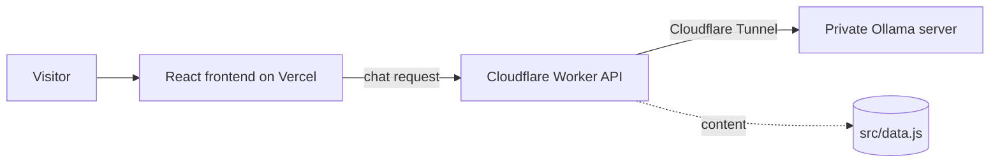

<div align="center">




<br/>


**[View the live portfolio](https://vcard-personal-portfolio-three-teal.vercel.app/)** · [GitHub](https://github.com/mosescodes5) · [LinkedIn](https://linkedin.com/in/moses-kouakanou-b7995b385/) · [X](https://x.com/oluwasekan)

</div>

---

## About this project

My personal portfolio: an iOS-inspired, motion-rich single-page site built with React, with an AI assistant that answers questions about my work.

| | |
|---|---|
| **Motion** | Hero lines that rise out of masks, a portrait that reveals from the bottom, a pulsing scroll button, scroll-driven outlined section words, counters, and a floating technology field. No mouse tracking, and all motion switches off for visitors who prefer reduced motion. |
| **Interactive** | Ctrl/Cmd + K command palette, filterable project index, expandable case rows, project detail sheets. |
| **AI assistant** | "Ask my AI" chat streamed from a Cloudflare Worker to a private Ollama model. It answers only from the content in `src/data.js` and says so when it does not know. |
| **Design** | Dark developer-template layout: top navigation, headline with a cut-out portrait, info columns, browser-window project mockups with stack logos and links. shadcn/ui on Tailwind CSS, Space Grotesk and Inter. |

## Architecture



The site works fully without the AI backend. If the Worker or Ollama is offline, the chat shows an offline message and everything else keeps working.

## Getting started

```powershell
npm install
npm run dev
```

All portfolio content lives in **`src/data.js`**: profile, skills, projects, experience and services. Edit that file and the site, the command palette and the AI assistant all update.

### Add your CV

Put a PDF at `public/assets/cv/Moses-Kouakanou-CV.pdf`. The Download CV button switches on automatically when the file exists.

## Deploy

### Frontend on Vercel

Import the repository in Vercel. It detects Vite: build command `npm run build`, output directory `dist`. Every push to `main` redeploys.

### AI backend on Cloudflare Workers

1. Run Ollama on a machine you control and expose it only through a [Cloudflare Tunnel](https://developers.cloudflare.com/cloudflare-one/connections/connect-networks/), ideally protected with Cloudflare Access.
2. Deploy the Worker:
   ```powershell
   npx wrangler login
   npx wrangler secret put OLLAMA_BASE_URL --config worker/wrangler.toml
   npm run worker:deploy
   ```
3. Set `ALLOWED_ORIGIN` in `worker/wrangler.toml` to your Vercel URL.
4. In Vercel, add the environment variable `VITE_API_URL` with your Worker URL and redeploy.

## Admin dashboard

Open `https://your-site/#admin` and sign in. From there you can add, edit, reorder, publish/unpublish and delete projects, upload screenshots, and upload or replace your CV, with no code changes. Everything is stored on Cloudflare (D1 database, R2 bucket) and protected by a server-side login.

One-time setup:

```powershell
npx wrangler login
npx wrangler d1 create portfolio                       # copy the database_id into worker/wrangler.toml
npx wrangler r2 bucket create portfolio-media
npx wrangler d1 execute portfolio --remote --file worker/schema.sql --config worker/wrangler.toml
npx wrangler secret put ADMIN_PASSWORD --config worker/wrangler.toml   # your login password
npx wrangler secret put JWT_SECRET --config worker/wrangler.toml       # any long random string
npm run worker:deploy
```

Until you add projects in the dashboard, the site shows the starter list from `src/data.js`. Use "Import starter projects" once to copy them into the database.

## Project structure

```
src/
  App.jsx                 page layout and sections
  data.js                 all editable content
  components/
    Motion.jsx            animation building blocks
    Assistant.jsx         AI chat sheet
    Palette.jsx           command palette
    ProjectDialog.jsx     project detail sheet
    ui/                   shadcn/ui components
worker/                   Cloudflare Worker (AI API)
docs/                     animated README graphics
```

## Notes

Content in this repository is about my real work only. Nothing is invented, and the assistant is instructed to say when it does not have verified information.
