<div align="center">




<br/>


**[View the live portfolio](https://vcard-personal-portfolio-three-teal.vercel.app/)** · [GitHub](https://github.com/mosescodes5) · [LinkedIn](https://linkedin.com/in/moses-kouakanou-b7995b385/) · [X](https://x.com/oluwasekan)

</div>

---

## About this project

My personal portfolio: an iOS-inspired, motion-rich single-page site built with React, with an AI assistant that answers questions about my work.

| | |
|---|---|
| **Motion** | Hero lines that rise out of masks, a portrait that reveals from the bottom, a pulsing scroll button, scroll-driven outlined section words, counters, and a floating technology field. No mouse tracking, and all motion switches off for visitors who prefer reduced motion. |
| **Interactive** | Ctrl/Cmd + K command palette, filterable project index, expandable case rows, project detail sheets. |
| **AI assistant** | Optional "Ask my AI" chat. It is hidden until an AI backend is connected (`VITE_API_URL`); the site and admin work fully without it. |
| **Design** | Dark developer-template layout: top navigation, headline with a cut-out portrait, info columns, browser-window project mockups with stack logos and links. shadcn/ui on Tailwind CSS, Space Grotesk and Inter. |

## Architecture

React frontend on Vercel, talking straight to Supabase: Postgres for projects, Storage for images, videos and the CV, Auth for the single admin login. Row Level Security (see `supabase/setup.sql`) means visitors can only read published projects, and only the admin email can change anything.

## Getting started

```powershell
npm install
npm run dev
```

All portfolio content lives in **`src/data.js`**: profile, skills, projects, experience and services. Edit that file and the site, the command palette and the AI assistant all update.

### Add your CV

Put a PDF at `public/assets/cv/Moses-Kouakanou-CV.pdf`. The Download CV button switches on automatically when the file exists.

## Deploy

### Frontend on Vercel

Import the repository in Vercel. It detects Vite: build command `npm run build`, output directory `dist`. Every push to `main` redeploys.

### Backend on Supabase (projects, uploads, admin login)

1. Create a free project at [supabase.com](https://supabase.com).
2. **SQL Editor** > New query > paste the contents of `supabase/setup.sql` (change the email in it if yours differs) > Run.
3. **Authentication > Users > Add user > Create new user**: your email and a long password, with Auto Confirm User ticked. This is your admin login.
4. **Authentication > Sign In / Providers**: turn off "Allow new users to sign up".
5. **Project Settings > API**: copy the Project URL and the anon (or publishable) key. Never use the `service_role` key in this project.
6. Local `.env` (see `.env.example`) and Vercel > Settings > Environment Variables: set `VITE_SUPABASE_URL` and `VITE_SUPABASE_ANON_KEY`, then redeploy.

## Admin dashboard

Open `https://your-site/#admin`, sign in with your email and password, click **New project**, paste the live link (the title fills in), then drop, browse or paste (Ctrl+V) a screenshot. Optionally upload an MP4 or WebM (up to 40 MB). With no image, the site shows an automatic preview of the link. You can also reorder, publish or hide, edit and delete projects, and upload your CV.

Until you add projects, the site shows the starter list from `src/data.js`. Use "Import starter projects" once to copy them into the database.

## Project structure

```
src/
  App.jsx                 page layout and sections
  data.js                 all editable content
  components/
    Motion.jsx            animation building blocks
    Assistant.jsx         AI chat sheet
    Palette.jsx           command palette
    ProjectDialog.jsx     project detail sheet
    ui/                   shadcn/ui components
supabase/setup.sql        database, storage and security rules
docs/                     animated README graphics
```

## Notes

Content in this repository is about my real work only. Nothing is invented, and the assistant is instructed to say when it does not have verified information.

## Videos and the avatar

In the admin you can upload an MP4 or WebM (up to 40 MB) for any project. It plays when visitors hover the card and in the project details.

The round avatar in the header and About section fades between a bitmoji and your photo. Save your bitmoji as `public/assets/images/moses-bitmoji.png` (square, transparent PNG works best). Until that file exists, the photo shows on its own.

## Pushing to GitHub

```powershell
git checkout -b redesign
git add .
git commit -m "Admin uploads, video support, avatar, skills"
git push -u origin redesign
```

Vercel builds a preview of the branch. When it looks right, open a Pull Request on GitHub and merge it into `main`.
